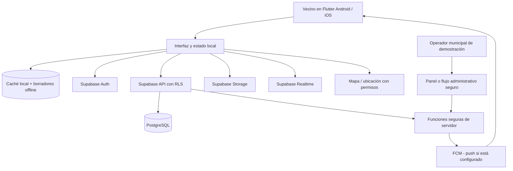

# Vibe_Pers — Especificación funcional y técnica del MVP

> **Proyecto:** Vibe_Pers — Hackathon UTP–El Comercio 2026  
> **Documento:** contexto maestro para IA de programación, diseño, base de datos y QA  
> **Versión:** 1.0 · 7 de noviembre de 2026  
> **Estado:** base de implementación; contiene decisiones confirmadas, recomendaciones de diseño y pendientes claramente identificados.  
> **Idioma:** español (Perú) · **Plataformas objetivo:** Android e iOS con Flutter.

## 0. Cómo deben utilizar este documento las otras IA

Este archivo es la **fuente compartida de requisitos**. Todas las IA deben leerlo **antes de generar código** y respetar estos criterios:

- **[CONFIRMADO]**: decisión explícita del equipo o requisito del reto. No cambiarla sin autorización.
- **[PROPUESTO PARA MVP]**: especificación operativa recomendada para resolver una ambigüedad. Implementarla como predeterminada, pero no atribuirla a las bases oficiales.
- **[PENDIENTE]**: asunto que debe validar el equipo. No inventar una respuesta definitiva.
- **[FUERA DE ALCANCE]**: no construir durante las 48 horas salvo cambio de prioridad explícito.

**Precedencia cuando haya contradicciones:** (1) reto oficial; (2) decisiones explícitas más recientes del equipo; (3) este documento; (4) documentación inicial; (5) interpretación de una IA. Si una IA encuentra una contradicción, debe **señalarla** antes de programar.

**Fuentes de esta versión:** documento «Reto de la chakaton.docx» (4 páginas, contiene el reto oficial y criterios), «Documentacion basica a mejorar - Hackaton.docx» (3 páginas, idea original) y respuestas del equipo en la conversación. Los detalles no fijados por esas fuentes aparecen como **propuestas** o **pendientes**.

**No confundir con simulacros anteriores:** el ejercicio «DataPeriodismo 360» y su stack Power BI / Data Mart / FastAPI **no pertenecen a este proyecto**. El reto real es vecinal, de proximidad, solidaridad y emergencias.

---

## 1. Contexto del reto oficial

### 1.1 Problema

Las personas necesitan identificar **productos, oficios y servicios próximos a su residencia** con poco gasto en desplazamiento, aprovechar recomendaciones confiables de otros vecinos, organizar **ayudas e intercambios solidarios** y localizar **servicios o grupos de apoyo en emergencias**.

### 1.2 Objetivo del MVP

Crear, en **48 horas**, una aplicación para ciudadanos que:

1. Permita descubrir productos y servicios del barrio, priorizando proximidad.
2. Facilite publicar servicios y compartir un **«Visto Bueno Vecinal»**.
3. Permita solicitar y ofrecer ayuda o intercambios solidarios **sin dinero**.
4. Permita identificar recursos y grupos de apoyo para emergencias y coordinar necesidades.

Requisitos transversales del reto: **geolocalización, tutorial de uso, enfoque móvil, máximo tres clics para publicar, funcionamiento online y offline, interfaz intuitiva y accesible**.

**Criterios publicados:** usabilidad, confiabilidad, escalabilidad, propuesta y consideración de riesgos/beneficios, funcionamiento completo de la interfaz, innovación y creatividad; en presentación: comunicación, tiempo, recursos audiovisuales, orden y respuestas a preguntas.

### 1.3 Posicionamiento de Vibe_Pers

**[CONFIRMADO]** Vibe_Pers será una app comunitaria que conecte vecinos de una misma junta vecinal. Mostrará personas y recursos relevantes, un mapa de servicios cercanos, un marketplace de productos y servicios con una sección diferenciada de solidaridad, y una pantalla de emergencias. Tendrá una identidad visual amigable con **avatares de patos** (decoración, no lógica de seguridad).

**Propuesta de valor breve:** «Encuentra lo que necesitas cerca, confía en las recomendaciones de tus vecinos y organiza ayuda cuando más importa».

**Límite ético:** la app **no reemplaza a Policía, Bomberos, SAMU, Defensa Civil ni otros servicios oficiales**; no debe afirmar que envía automáticamente avisos a autoridades si tal integración no existe.

---

## 2. Alcance y priorización

### 2.1 Obligatorio / P0

- Registro, inicio de sesión y selección de **una única junta vecinal**.
- Listado de comunidad y acceso a información básica del líder (si existe).
- Directorio, búsqueda y mapa/lista de **servicios y productos cercanos**.
- Publicación y consulta de productos y servicios; contacto externo mediante WhatsApp.
- **Visto Bueno Vecinal** con control de votos duplicados y moderación.
- Sección de **solicitudes y ofrecimientos solidarios sin dinero**, con estados.
- Emergencias: contactos, recursos/grupos, botón de alerta, ubicación compartida durante un tiempo limitado.
- Tutorial breve; navegación accesible; **flujo de publicación diseñado para un máximo de tres acciones principales** (véase advertencia en §7).
- Uso offline mínimo real y demostrable (caché, lectura local y borradores pendientes; no se prometen notificaciones sin internet).
- Controles de autorización, privacidad y pruebas de los flujos principales.

### 2.2 Complementario / P1, solo si P0 está estable

- Comentarios moderables en publicaciones.
- Avisos de líder comunitario.
- Roles de apoyo asignados por líder: brigadista, primeros auxilios, evacuación, daños, etc. **Etiquetas comunitarias; no certificaciones profesionales.**
- Información y trazados de rutas seguras guardados localmente con datos válidos para demostración.
- Filtros y ordenamiento mejorados, estética y animaciones.

### 2.3 Fuera de alcance / futuro

- Pagos dentro de la app, comisiones, pasarela de pagos y compras automatizadas.
- Chat en tiempo real propio, seguimiento de compras o logística de reparto.
- Lectura o detección de la duración de llamadas telefónicas para decidir si una alerta es verdadera.
- Conexión real con RENIEC, Migraciones, SUNAT o municipalidades sin convenio y credenciales.
- Verificación automática de identidad mediante reconocimiento facial/OCR de documentos.
- Dibujo de polígonos personalizados para definir límites barriales; geocodificación por código postal como única fuente de pertenencia.
- Motor de noticias generales, muro de quejas no relacionadas con el reto, recomendaciones de IA generativa sin validación.
- Trazado de rutas online a partir de cero o descarga masiva de mapas sin licencia.
- Recuperación de contraseña en dos pasos personalizada, sistemas complejos de reputación y análisis predictivo de desastres.
- Multicomunidad por usuario o cambio libre de comunidad sin control.

---

## 3. Tecnologías y arquitectura

### 3.1 Decisiones técnicas

| Capa | Tecnología | Estado | Motivo |
|---|---|---|---|
| Aplicación móvil | **Flutter + Dart** | **[CONFIRMADO]** | Una sola base de código para Android e iOS |
| IDE principal | Android Studio | **[CONFIRMADO]** | Desarrollo y pruebas Android |
| Pruebas | Android físico/emulador | **[CONFIRMADO]** | El equipo no dispone de Mac |
| Base de datos | **Supabase PostgreSQL** | **[PROPUESTO PARA MVP]**, aceptado como orientación | Persistencia relacional, políticas de acceso |
| Autenticación | Supabase Auth | **[PROPUESTO PARA MVP]** | Email + contraseña sin construir auth desde cero |
| Fotos y adjuntos | Supabase Storage | **[PROPUESTO PARA MVP]** | Buckets privados y de publicaciones |
| Eventos en vivo | Supabase Realtime | **[PROPUESTO PARA MVP]** | Actualización de alertas mientras la app está conectada |
| Notificaciones con app cerrada | Firebase Cloud Messaging + lógica de servidor | **[PROPUESTO PARA MVP / dependencia a validar]** | Realtime por sí solo no garantiza push en segundo plano |
| Mapas | Flutter Map / mapas con licencia adecuada | **[PROPUESTO PARA MVP]** | Geolocalización y puntos de interés |
| Offline | SQLite local o solución equivalente de caché/outbox | **[PROPUESTO PARA MVP]** | Información guardada y borradores |
| Versionado | Git + GitHub | **[CONFIRMADO como herramienta de trabajo]** | Trabajo de cinco integrantes |

**No se necesita FastAPI en el MVP si Flutter utiliza Supabase con RLS y funciones de servidor para acciones privilegiadas.** Incorporarlo después solo si aparece una razón concreta. **Nunca** conectar Flutter directamente con credenciales administrativas de PostgreSQL.

### 3.2 Vista de componentes



### 3.3 Principios

1. Datos persistidos en servidor y protegidos por **RLS** (*Row Level Security*); datos sensibles siempre privados.
2. Cliente Flutter solo conoce una **clave pública/anon** de Supabase. `service_role`, claves FCM y otras credenciales privilegiadas van **únicamente en servidor/secretos**, nunca en app ni GitHub.
3. Una comunidad por perfil; las consultas de datos vecinales se filtran por `community_id` y además se protegen en servidor con políticas.
4. **Offline-first limitado**: consultar caché y preparar borradores; sincronizar al reconectarse. El estado local debe distinguir datos desactualizados de actuales.
5. Estados explícitos: cargando, vacío, sin conexión, error, acceso denegado, operación pendiente, éxito.
6. **El código debe funcionar sin una municipalidad conectada ni un proveedor de identidad oficial**; esas integraciones son futuras.

### 3.4 Limitación iOS

**[CONFIRMADO]** El objetivo es Android e iOS, pero por ahora solo se verificará ejecutando en Android. **No afirmar que una compilación iOS ha sido validada**. Para compilar, firmar y probar iOS hará falta infraestructura compatible, normalmente Mac + Xcode, en una etapa posterior.

---

## 4. Roles y autorización

| Rol | Registro / consulta | Publicar y recomendar | Moderar / avisos | Gestionar líderes |
|---|---|---|---|---|
| Visitante no autenticado | Pantallas de bienvenida y login | No | No | No |
| Vecino autenticado | Sí, su comunidad | Sí, con restricciones | Reportar abusos; no eliminar contenido ajeno | No |
| Líder vecinal autorizado | Sí | Sí | Avisos comunitarios, moderación, verificación local de fichas, coordinación | No puede nombrarse a sí mismo ni nombrar autoridad municipal |
| Vecino con función de apoyo | Sí | Sí | Participación de apoyo acorde con función | No |
| Operador municipal autorizado | Acceso administrativo específico | No necesita actuar como vecino | Revisión administrativa necesaria | Sí, aprobar o retirar rol de líder |

**[CONFIRMADO]** Para tener rol `LIDER_VECINAL`, la persona **debe presentarse ante la municipalidad y obtener autorización**. La aplicación **no concede el rol automáticamente**. El líder puede moderar publicaciones, revisar fichas de negocios, crear avisos y coordinar emergencias.

**[PROPUESTO PARA DEMO]** Representar la autorización municipal mediante una cuenta administrativa de prueba y una acción segura `aprobar_lider`. Es una **simulación del procedimiento**, no una integración municipal real. Ningún personal externo tendrá acceso directo a la BD ni se entregarán credenciales privilegiadas.

**[CONFIRMADO]** Si la comunidad no tiene líder, **sigue funcionando** para los vecinos; se muestra un aviso no bloqueante invitando a organizar una convocatoria. La eventual convocatoria ocurre entre vecinos; la designación del rol oficial sigue requiriendo autorización municipal.

**[CONFIRMADO]** Los subroles («primeros auxilios», «monitor de evacuación», «brigadista», «monitor de daños») pueden ser asignados por el líder. **[PROPUESTO]** Son etiquetas operativas dentro de la app: no suponen formación ni acreditación oficial.

**Regla de seguridad:** el rol se verifica en servidor; modificar un campo o una pantalla de Flutter no debe permitir convertirse en líder o municipal.

---

## 5. Navegación y pantallas

### 5.1 Antes de entrar

- **Splash / estado de sesión:** comprobar sesión y datos básicos.
- **Tutorial de primer uso:** hasta 3 pantallas breves: (1) servicios cercanos y recomendaciones, (2) ayuda solidaria, (3) emergencias y funcionamiento offline. Controles **Siguiente**, **Omitir**, **Empezar**.
- **Registro**: correo, contraseña, tipo/número de documento, foto de documento, nombre visible, permisos solicitados según necesidad y elección de comunidad.
- **Login**: correo y contraseña; mensajes seguros de error.
- **Selección de zona:** GPS sugiere zona vecinal; usuario confirma o elige manualmente entre comunidades precargadas.

### 5.2 Navegación principal (4 pestañas)

1. **Comunidad**: vecinos, líderes (si existen), avisos, grupos de apoyo, tarjetas/avatares de patos.
2. **Mapa**: servicios locales y puntos de interés; detalle, Visto Bueno Vecinal, opciones de ruta externa, servicios de apoyo.
3. **Mercado y solidaridad**: pestañas internas separadas **Ventas/Servicios** y **Ayuda sin dinero**; búsquedas, publicaciones, solicitudes y estados.
4. **Emergencias**: botón SOS independiente, números de emergencia, grupos/recursos, zonas seguras/rutas disponibles.

**Acciones globales:** botón visible **Publicar**; acceso a Mi perfil, Mis publicaciones, Mis ayudas, Mis alertas, Ajustes, Cambiar de junta (mediante solicitud), Información offline y Cerrar sesión.

**[CONFIRMADO]** Los avatares de vecinos serán patos; el líder tendrá distintivo visual. El tema de patos es una decisión gráfica, **no** un indicador de verificación, ubicación o autoridad.

### 5.3 Ficha de vecino

Muestra nombre visible, avatar, función vecinal voluntaria, publicaciones públicas propias y botón de ver productos/servicios. **No mostrar** documento, fotografía del documento, correo privado, ubicación exacta ni teléfono salvo divulgación explícita por el usuario.

### 5.4 Ficha de servicio/producto

Mostrar nombre, categoría, descripción, foto, precio si corresponde, zona, distancia **aproximada si hay permiso GPS**, fecha, propietario, número de recomendaciones vecinales (para servicios), comentarios permitidos y **Contactar por WhatsApp** si el anunciante publicó voluntariamente ese medio.

---

## 6. Requisitos funcionales por módulo

### 6.1 RF-REG — Cuenta y registro

- **RF-REG-01 [CONFIRMADO]** Crear cuenta con correo y contraseña.
- **RF-REG-02 [CONFIRMADO]** Solicitar **tipo de documento** (`DNI`, `CE`, `PASAPORTE`), **número** y **foto** del documento; campos obligatorios para completar registro.
- **RF-REG-03 [CONFIRMADO]** Impedir registros completos con **la misma combinación de tipo y número de documento normalizado**. La unicidad debe validarse **en el servidor** y garantizarse con índice único, no únicamente en Flutter. Ejemplo: dos DNI iguales no se permiten; los demás documentos siguen la misma regla por tipo.
- **RF-REG-04 [CONFIRMADO]** No integrar en el MVP un organismo externo de validación de identidad.
- **RF-REG-05 [CONFIRMADO]** Login con correo y contraseña, con hashing y seguridad delegados a un proveedor de autenticación probado. No almacenar contraseñas manualmente.
- **RF-REG-06 [CONFIRMADO]** Solicitar ubicación para **sugerir** la junta vecinal; el usuario confirma la comunidad o la elige de una lista si rechaza GPS.
- **RF-REG-07 [CONFIRMADO]** Cada usuario pertenece como máximo a **una junta vecinal activa**. No puede unirse simultáneamente a varias.
- **RF-REG-08 [CONFIRMADO]** El cambio de junta vecinal queda como **función adicional**. **[PROPUESTO]** Crear una solicitud revisable, no permitir alternancia instantánea.
- **RF-REG-09 [PROPUESTO]** Permitir registro incompleto solo como estado `PENDIENTE`; impedir uso de módulos sociales hasta completar identidad/comunidad.
- **RF-REG-10 [PROPUESTO]** La foto de documento queda en almacenamiento privado; no se expone al líder ni a otros vecinos. Solo personal expresamente autorizado debería acceder si existe revisión humana.
- **RF-REG-11 [PROPUESTO]** Evitar guardar número visible de documento en tablas públicas; mostrarlo enmascarado.

**Nota de privacidad:** impedir duplicados **no verifica** si el documento pertenece a la persona. No presentar la cuenta como «identidad verificada oficialmente». Pedir consentimiento informado, limitar almacenamiento y definir retención/eliminación antes de uso real. En el simulacro usar **solo documentos y fotos ficticios**, jamás DNI reales.

**Validaciones mínimas:** email válido; contraseña según política de Auth; tipo permitido; número no vacío y normalizado; foto PNG/JPEG válida y de tamaño controlado; comunidad seleccionada. Error duplicado: mensaje que no divulgue datos de otro vecino.

### 6.2 RF-COM — Comunidad / junta vecinal

- **RF-COM-01 [CONFIRMADO]** Mostrar vecinos de la junta propia mediante tarjetas con avatar de pato, nombre y función visible.
- **RF-COM-02 [CONFIRMADO]** Distinguir al líder autorizado; tocarlo muestra descripción de la junta y un contacto WhatsApp solo si el líder lo habilitó.
- **RF-COM-03 [CONFIRMADO]** Mostrar grupos de apoyo e integrantes asignados; líder puede asignar subroles comunitarios.
- **RF-COM-04 [CONFIRMADO]** Si no hay líder, mostrar recordatorio: «Tu comunidad aún no tiene líder. Organicen una convocatoria vecinal y soliciten autorización municipal»; no bloquear funciones ordinarias.
- **RF-COM-05 [CONFIRMADO]** Líder puede emitir anuncios comunitarios; el equipo podrá cargar ejemplos de colectas y avisos tras un desastre, claramente ficticios.
- **RF-COM-06 [PROPUESTO]** Líder modera contenido de su comunidad; registrar motivo, fecha y moderador. Eliminar = despublicar lógicamente, preservando auditoría.

### 6.3 RF-MAP — Servicios de proximidad y mapa

- **RF-MAP-01 [CONFIRMADO]** Mostrar mapa o lista de productos, oficios, profesionales, negocios y puntos de interés vinculados a la zona vecinal.
- **RF-MAP-02 [CONFIRMADO]** Permitir categorías como gasfitería, electricidad, carpintería, clases, cerrajería, paseo de mascotas y apoyo de emergencia.
- **RF-MAP-03 [CONFIRMADO]** Al tocar un marcador, mostrar ficha con descripción, ubicación aproximada, valoraciones/recomendaciones y comentarios disponibles.
- **RF-MAP-04 [CONFIRMADO]** Ofrecer acción **Abrir ruta en aplicación de mapas**. Depende de internet y de que exista una app de mapas compatible; no se promete navegación interna integral.
- **RF-MAP-05 [CONFIRMADO]** Mostrar rutas o lugares seguros precargados para emergencias; guardar información disponible localmente.
- **RF-MAP-06 [PROPUESTO]** Filtro por categoría y búsqueda textual; si GPS está denegado, usar comunidad seleccionada sin bloquear resultados.
- **RF-MAP-07 [PROPUESTO]** No exponer la ubicación residencial exacta de vendedores/vecinos por defecto. Para servicios domiciliarios, mostrar área aproximada o punto comercial consentido.
- **RF-MAP-08 [PROPUESTO]** Señalar claramente la distancia como aproximación y no prometer «menor costo» sin precios verificables.

**Advertencia offline:** datos GeoJSON y rutas previamente descargados se pueden ver sin conexión; un mapa base completo **solo** si existe una fuente de teselas y licencia que permita almacenamiento offline. No descargar masivamente teselas de servidores públicos sin autorización.

### 6.4 RF-REC — Visto Bueno Vecinal

- **RF-REC-01 [CONFIRMADO como mecanismo aprobado]** Un vecino autenticado de la **misma comunidad** puede emitir un «Visto Bueno» sobre un servicio.
- **RF-REC-02 [PROPUESTO PARA MVP]** Cada vecino puede tener **como máximo un voto activo por servicio** (`UNIQUE(voter_id, listing_id)`).
- **RF-REC-03 [PROPUESTO]** No se permite recomendar un servicio propio; valida el backend.
- **RF-REC-04 [PROPUESTO]** Se puede retirar el voto. Contador visible = votos activos únicos, no una reputación oficial.
- **RF-REC-05 [PROPUESTO]** Comentarios/reseñas pueden denunciarse; el líder puede ocultar material abusivo, dejando auditoría. No permitir que elimine arbitrariamente votos ajenos como si fueran inexistentes.
- **RF-REC-06 [PROPUESTO]** Distinguir claramente **«Recomendado por N vecinos»** de **«Ficha revisada por líder»**; revisar una ficha **no** certifica profesionalmente al vendedor.

**Riesgo residual:** es imposible garantizar ausencia total de reseñas maliciosas con un simple documento o voto único. No prometer «reseñas 100 % reales».

### 6.5 RF-MKT — Venta de productos y servicios (con dinero)

- **RF-MKT-01 [CONFIRMADO]** Un vecino puede crear un anuncio con **foto, título, descripción, precio, categoría y ubicación/zona**.
- **RF-MKT-02 [CONFIRMADO]** Otros vecinos pueden buscar, filtrar y abrir el detalle.
- **RF-MKT-03 [CONFIRMADO]** El contacto es **solo mediante WhatsApp externo**; no existe carrito ni pago dentro de Vibe_Pers.
- **RF-MKT-04 [PROPUESTO]** El vendedor debe aceptar publicar un medio de contacto. Si no lo permite, no se muestra un número privado.
- **RF-MKT-05 [PROPUESTO]** Orden predeterminado: (a) comunidad del usuario, (b) coincidencia de búsqueda, (c) cercanía cuando sea posible, (d) cantidad de vistos buenos **solo en servicios**, (e) recientes. Permitir elegir «más recientes» y «menor precio» si hay datos comparables.
- **RF-MKT-06 [CONFIRMADO]** Si no encuentra lo que busca, el vecino puede crear una **solicitud**; debe elegir si se trata de una búsqueda comercial o una necesidad solidaria.
- **RF-MKT-07 [PROPUESTO]** Estado del anuncio: `ACTIVO`, `OCULTO`, `CERRADO`; autor puede cerrar; líder puede ocultar con motivo. No borrar datos sin auditoría.

### 6.6 RF-SOL — Cadena de favores y solidaridad (sin dinero)

- **RF-SOL-01 [CONFIRMADO]** Existirá una sección **separada** de ventas/servicios pagados.
- **RF-SOL-02 [CONFIRMADO]** Se pueden publicar **necesidades** u **ofrecimientos** para donaciones, préstamo de objetos, ayuda temporal, intercambio de habilidades o trueques sin dinero.
- **RF-SOL-03 [CONFIRMADO]** Ejemplo obligatorio de funcionamiento: vecino solicita silla de ruedas prestada → otro responde → solicitante acepta → marca como resuelto/devolución cuando corresponda.
- **RF-SOL-04 [PROPUESTO]** Publicación incluye tipo (`SOLICITO`/`OFREZCO`), categoría de ayuda, descripción, zona, foto opcional, fecha y modalidad (`DONACIÓN`, `PRÉSTAMO`, `TRUEQUE`, `VOLUNTARIADO`). **No tiene precio**.
- **RF-SOL-05 [PROPUESTO]** Estados: `ABIERTA`, `EN_COORDINACIÓN`, `RESUELTA`, `CANCELADA`. Solo autor puede aceptar ofrecimiento/cerrar, o líder puede intervenir en abuso con auditoría.
- **RF-SOL-06 [PROPUESTO]** El contacto se acuerda mediante canal consentido, p. ej., WhatsApp; no compartir teléfonos personales sin consentimiento.
- **RF-SOL-07 [CONFIRMADO por reto]** Durante emergencias, listar necesidades y recursos críticos para coordinar ayuda humanitaria en la propia comunidad.

### 6.7 RF-EMG — Emergencias (flujo sensible)

- **RF-EMG-01 [CONFIRMADO]** La cuarta pestaña muestra **botón SOS independiente de las llamadas**.
- **RF-EMG-02 [CONFIRMADO]** Activación táctil normal: apoyar **dos dedos al mismo tiempo sobre el botón SOS** y mantenerlos durante **dos segundos continuos**. Si se suelta antes, no se envía.
- **RF-EMG-03 [PROPUESTO]** Mostrar animación/progreso visible durante los dos segundos, vibración si está habilitada y confirmación visual al enviar. No iniciar alertas con un simple toque.
- **RF-EMG-04 [PROPUESTO ACCESIBLE, aprobado en principio]** Ofrecer alternativa accesible para quien no pueda usar dos dedos: botón «Activar sin gesto multitáctil» → confirmación clara de emergencia. Conservar protección contra activaciones accidentales.
- **RF-EMG-05 [CONFIRMADO]** Al activarse, notificar a **otros vecinos de la junta** y compartir la ubicación del emisor en **tiempo real mientras esté activa**, sujeto a conectividad y permisos.
- **RF-EMG-06 [CONFIRMADO]** Duración máxima inicial de ubicación compartida: **15 minutos**. El emisor puede **finalizar antes** o **extender manualmente** el período.
- **RF-EMG-07 [PROPUESTO]** Cada extensión añade **15 minutos** y registra `expires_at`; nunca extender silenciosamente.
- **RF-EMG-08 [PROPUESTO]** Intentar actualizar la posición a intervalos razonables durante una alerta activa (p. ej., 10–15 s si hay movimiento y conexión); mostrar hora de última actualización. No declarar «en vivo» una ubicación vieja.
- **RF-EMG-09 [PROPUESTO]** Al finalizar, vencer o cancelar, dejar de enviar ubicaciones y restringir su consulta. Guardar lo mínimo necesario para auditoría; definir borrado de coordenadas históricas.
- **RF-EMG-10 [CONFIRMADO]** Mostrar contactos generales de emergencias y botón para **abrir marcador de teléfono**. La app **no inspecciona ni cronometra la llamada**.
- **RF-EMG-11 [CONFIRMADO por reto]** Mostrar grupos, recursos, puntos seguros y solicitudes humanitarias de apoyo disponibles.
- **RF-EMG-12 [PROPUESTO]** Si no hay GPS o internet, mostrar error entendible, ofrecer números de teléfono y recursos offline; **no afirmar que la alerta llegó** si no hay confirmación del servidor.
- **RF-EMG-13 [PROPUESTO]** Solo usuarios autenticados **de la misma comunidad** y autorizados para ver la alerta recibirán la posición, durante su vigencia; no hacer pública la localización ni compartirla fuera de la junta.
- **RF-EMG-14 [PROPUESTO]** Proveer acción «Fue una falsa alerta / Cancelar» con cancelación inmediata y notificación de cierre si ya se había enviado.
- **RF-EMG-15 [PROPUESTO]** Notificaciones push cuando la app esté cerrada requieren configuración de FCM y envío desde el servidor. Sin esa configuración, la app mostrará alertas en tiempo real **solo mientras el cliente esté conectado**. Debe quedar explícito en la demo.

**No se garantiza** entrega en emergencias reales, precisión exacta del GPS, servicio en segundo plano en iOS/Android, disponibilidad de redes ni respuesta de autoridades. No utilizar esta app como único medio de solicitud de auxilio real.

### 6.8 RF-OFF — Online y offline

| Comportamiento | Con internet | Sin internet |
|---|---|---|
| Ver contactos de emergencias precargados | Sí | Sí, si están guardados |
| Ver ficha de comunidad/servicios vistos | Sí | Sí, caché con «Última actualización» |
| Ver zonas seguras/rutas precargadas | Sí | Datos locales; mapas base solo con licencia/caché permitida |
| Crear anuncio o ayuda | Publicar | Guardar **borrador PENDIENTE** para sincronizar |
| Recomendar o comentar | Sí | No confirmar voto remoto; opcional registrar acción pendiente sin mostrar como publicada |
| Consultar novedades de vecinos | Sí | No; mostrar último contenido descargado |
| Alertar a vecinos / compartir ubicación | Sí, si servidor responde | **No disponible**; mostrar advertencia sin promesa de envío |
| Abrir marcador de teléfono | Sí | Posible sin internet **si existe señal/servicio telefónico** |

**[PROPUESTO]** Cada borrador offline tiene UUID local, creación, tipo, payload, imágenes locales y estado `PENDIENTE / SINCRONIZANDO / ENVIADO / ERROR`. Reintento seguro tras reconexión con clave de idempotencia para evitar publicaciones duplicadas.

### 6.9 RF-UX — Tutorial, accesibilidad y publicación rápida

- **RF-UX-01 [CONFIRMADO]** Tutorial muy breve y fácil de omitir.
- **RF-UX-02 [CONFIRMADO]** Tipografía legible, controles grandes, etiquetas visibles, contraste adecuado y navegación consistente.
- **RF-UX-03 [CONFIRMADO POR RETO]** **Máximo tres clics para publicar**; diseñar con ello en mente.
- **RF-UX-04 [PROPUESTO]** Botón **Publicar** accesible desde la navegación principal, formulario único y acción final clara; precargar zona, autor y fecha.
- **RF-UX-05 [PROPUESTO]** Lectores de pantalla: textos semánticos para iconos, no depender únicamente de color ni del gesto multitáctil para emergencias.
- **RF-UX-06 [PROPUESTO]** Offline y permisos no deben dejar una pantalla en blanco; ofrecer alternativa manual y estado informativo.

**ATENCIÓN AL REQUISITO «3 CLICS»:** flujo propuesto (desde inicio): (1) tocar **Publicar**, (2) seleccionar tipo **Producto / Servicio / Ayuda**, (3) tocar **Publicar ahora** luego de completar campos. **Es una interpretación de «3 acciones principales»**, no una demostración de tres toques literales totales: escribir, subir foto o seleccionar ubicación requiere interacciones adicionales. **[PENDIENTE CRÍTICO]** Confirmar con los organizadores cómo cuentan los clics. Si consideran *todos* los toques, utilizar fichas predefinidas, edición en una pantalla y métodos de entrada accesibles para reducir interacciones.

---

## 7. Flujos de usuario de extremo a extremo

### F-01 — Primer registro (camino feliz)

1. Abre app → tutorial breve (puede omitir).
2. Elige **Crear cuenta**.
3. Introduce correo, contraseña, nombre visible, tipo y número de documento; adjunta foto **ficticia en demo**.
4. El cliente solicita verificación de duplicado por servicio **privado de servidor**.
5. El usuario da permiso de ubicación opcional; la app propone una comunidad cercana o permite seleccionar manualmente.
6. Confirma **una comunidad**; finaliza registro.
7. Supabase Auth crea sesión y el perfil queda completo; redirige a pestaña **Comunidad**.

**Errores:** correo existente, documento duplicado, foto inválida, fallo red, GPS denegado, sin junta disponible. **Ninguno** debe dejar un estado de identidad parcial utilizable como cuenta aprobada.

### F-02 — Descubrir un servicio y recomendarlo

1. Abre **Mapa** o buscador → elige «Electricista».
2. Ve resultados de su junta, con proximidad y «Recomendado por N vecinos».
3. Abre ficha → revisa descripción y comentarios.
4. Toca **Dar Visto Bueno** si no es propietario y no tiene voto activo.
5. Servidor valida usuario, junta, anuncio activo y unicidad; contador se actualiza.
6. Si necesita contactar, toca **WhatsApp** (si el vendedor consintió publicar el número).

**Casos negativos:** voto repetido, servicio propio, anuncio fuera de comunidad, sin conexión, vendedor sin WhatsApp.

### F-03 — Publicar un producto o servicio

1. Toca **Publicar** → elige tipo **Producto** o **Servicio**.
2. Completa título, categoría, foto, descripción, precio y zona; la zona viene precargada y es editable.
3. Confirma **Publicar ahora** → registro persistido con propietario y comunidad.
4. La ficha se ve en **Mercado** y, si tiene coordenadas permitidas, en **Mapa**.
5. Otro vecino lo abre y contacta por WhatsApp si hay consentimiento.

**Casos negativos:** precio inválido, falta foto, sin WhatsApp autorizado, despublicación por líder, sin internet (borrador).

### F-04 — Pedir ayuda gratuita y resolverla

1. **Publicar → Ayuda → Necesito ayuda**.
2. Vecino crea solicitud «Préstamo de silla de ruedas» sin campo precio.
3. Otro vecino abre solicitud y responde «Puedo prestarla».
4. Autor revisa respuesta, la acepta y se marca `EN_COORDINACIÓN`.
5. Tras entrega/acuerdo, autor la marca `RESUELTA`; se conserva historial mínimo.

**Casos negativos:** autor intenta aceptar respuesta de otro pedido; usuario de otra junta intenta ver; se cancela oferta; no hay propuestas; conexión perdida.

### F-05 — Emitir alerta SOS y compartir ubicación 15 minutos

1. Usuario abre **Emergencias** y acepta permiso de ubicación necesario para compartirla.
2. Coloca **dos dedos** sobre SOS por **2 s continuos** (o usa vía accesible alternativa con confirmación).
3. Se visualiza «Enviando alerta…»; el servidor valida sesión, junta y que no haya alerta activa incompatible.
4. Se crea `alert` con `started_at` y `expires_at = started_at + 15 min`.
5. Al recibir confirmación, la app muestra «Alerta enviada»; los vecinos conectados de la junta pueden verla. Push solo si está configurado.
6. La app publica actualizaciones de ubicación permitidas con su marca temporal. Receptores ven estado **Activo**, hora de posición y datos de ayuda, no el documento del emisor.
7. El emisor puede **Finalizar ahora** o **Extender +15 min** (acción manual).
8. Al vencer o finalizar: estado `FINALIZADA/EXPIRADA`; deja de compartir posición; receptores ven la alerta cerrada sin localización activa.

**Casos negativos críticos:** soltó dedo antes de 2s, GPS apagado, red caída, denegación de permisos, móvil en segundo plano, push no configurado, alerta expiró, usuario ajeno a la junta, falsa alarma cancelada. **Nunca** mostrar «enviada» antes de respuesta del servidor.

### F-06 — Líder autorizado y junta sin líder

1. Usuario común ve «No hay líder asignado»; sigue usando servicios y ayuda.
2. Vecinos organizan convocatoria fuera del flujo de aprobación automático.
3. Persona se presenta a municipalidad y solicita autorización (**proceso organizacional, no verificado mediante API**).
4. Cuenta municipal **de demostración** recibe resultado administrativo y ejecuta «Aprobar rol de líder».
5. Un servicio seguro valida rol municipal, registra aprobación y cambia rol de usuario.
6. Usuario reingresa/actualiza sesión y obtiene opciones de moderación/avisos.

**No** permitir que el candidato o el líder vigente se asignen por sí mismos el permiso municipal.

### F-07 — Uso offline y sincronización

1. Usuario abre app sin red; ve datos precargados con indicador «Sin conexión / última sincronización».
2. Consulta números de emergencia, fichas y rutas almacenadas.
3. Crea solicitud solidaria; al enviar, se guarda en caché con estado `PENDIENTE`, **no** visible a otros.
4. Al volver internet, sincronizador solicita autenticación válida, carga foto y envía registro con idempotencia.
5. Confirma estado `ENVIADO` o deja `ERROR` con reintento manual; evita duplicados.

---

## 8. Estados y reglas de negocio transversales

| Entidad | Estados | Transiciones válidas principales |
|---|---|---|
| Perfil | `PENDIENTE`, `ACTIVO`, `SUSPENDIDO` | `PENDIENTE → ACTIVO`; suspensión administrativa |
| Anuncio | `ACTIVO`, `CERRADO`, `OCULTO` | Autor cierra; líder oculta con motivo |
| Ayuda solidaria | `ABIERTA`, `EN_COORDINACION`, `RESUELTA`, `CANCELADA` | Autor decide aceptar/resolver/cancelar |
| Alerta SOS | `ACTIVA`, `FINALIZADA`, `EXPIRADA`, `CANCELADA` | Finalizar/cancelar antes; expirar por reloj servidor |
| Solicitud cambio junta | `PENDIENTE`, `APROBADA`, `RECHAZADA` | Operador de revisión; **[PENDIENTE]** quién aprueba |
| Solicitud líder | `PENDIENTE`, `APROBADA`, `RECHAZADA` | Solo operador municipal autorizado |
| Elemento offline | `PENDIENTE`, `SINCRONIZANDO`, `ENVIADO`, `ERROR` | Reintentos idempotentes |

**Restricciones fundamentales:**

1. Un mismo documento (tipo+número normalizados) no pertenece a dos perfiles activos/completos.
2. Un perfil tiene una junta vecinal activa.
3. Autor no puede emitir visto bueno en su propio servicio; un vecino un voto activo por servicio.
4. Un vecino solo ve información **vecinal privada** de su junta. Catálogo de números públicos de emergencia puede ser global.
5. Un usuario no puede otorgarse permisos de líder o municipal.
6. Una alerta caduca en servidor al cumplirse 15 min si no se extiende; un cron/consulta en backend debe aplicar expiración aunque el teléfono esté apagado.
7. La ubicación solo está disponible a receptores autorizados mientras la alerta esté vigente.
8. Sin conexión no se puede confirmar una alerta enviada, ni votos o publicaciones sincronizadas.
9. Las fotos de identidad se guardan en bucket **privado** diferente del bucket de fotos de anuncios.
10. Los ejemplos de vecinos, negocios, brigadistas, municipalidades y rutas de la demo deben indicar **«datos ficticios de demostración»**.

---

## 9. Modelo de datos de referencia (PostgreSQL / Supabase)

> **[PROPUESTO PARA MVP]** Este esquema es una especificación lógica para el responsable de BD. Aún hay que transformarlo en migraciones SQL, índices, RLS, seeds y pruebas. No crear tablas públicas para secretos ni duplicar funcionalidades de `auth.users`.

| Tabla | Campos principales | Reglas / relaciones |
|---|---|---|
| `communities` | `id uuid PK`, `name`, `district`, `area_label`, `center_lat`, `center_lng`, `created_at` | Comunidades de demostración configuradas de antemano |
| `profiles` | `id uuid PK`, `display_name`, `community_id FK`, `role`, `avatar_code`, `status`, `created_at` | `id` referencia `auth.users.id`; una comunidad activa por perfil |
| `identity_documents` (privada) | `user_id PK/FK`, `doc_type`, `doc_number_normalized` (privado), `photo_storage_path`, `created_at` | `UNIQUE(doc_type, doc_number_normalized)`; no exposición en lecturas vecinales; política de retención pendiente |
| `leader_requests` | `id`, `applicant_id FK`, `community_id FK`, `status`, `approved_by FK`, `decision_at`, `notes` | Solo operador municipal puede aprobar y cambiar rol |
| `community_support_roles` | `id`, `user_id FK`, `community_id FK`, `support_role`, `assigned_by FK` | Asignación por líder; no implica certificación |
| `listings` | `id`, `seller_id FK`, `community_id FK`, `kind`, `category`, `title`, `description`, `price`, `lat`, `lng`, `whatsapp_public`, `status`, `created_at` | `kind=PRODUCT/SERVICE`; `price >= 0`; ubicación compartida consentida |
| `listing_photos` | `id`, `listing_id FK`, `storage_path`, `position` | Archivos de publicación separados de identidad |
| `recommendations` | `id`, `listing_id FK`, `voter_id FK`, `is_active`, `created_at` | `UNIQUE(listing_id, voter_id)`; solo servicios y distinta persona del propietario |
| `listing_comments` | `id`, `listing_id FK`, `author_id FK`, `body`, `hidden_at`, `created_at` | Denuncia y moderación; opcional P1 |
| `solidarity_posts` | `id`, `author_id FK`, `community_id FK`, `direction`, `mode`, `title`, `description`, `status`, `created_at` | `direction=NEED/OFFER`; `mode=DONATION/LOAN/BARTER/VOLUNTEER`; sin precio |
| `solidarity_responses` | `id`, `post_id FK`, `responder_id FK`, `message`, `status`, `created_at` | Autor del pedido decide aceptación |
| `community_announcements` | `id`, `community_id FK`, `author_id FK`, `title`, `body`, `created_at` | Solo líder autorizado en su junta |
| `emergency_contacts` | `id`, `name`, `number`, `zone_label`, `source_note`, `verified_at` | Datos oficiales verificados antes de uso real; demo sin simulación de llamadas reales |
| `emergency_resources` | `id`, `community_id FK`, `title`, `kind`, `lat`, `lng`, `details`, `is_demo` | Grupos, servicios, zonas seguras y recursos comunitarios |
| `safe_routes` | `id`, `community_id FK`, `name`, `geojson`, `source_note`, `is_demo` | Rutas descargables localmente si fuente/licencia lo permite |
| `emergency_alerts` | `id`, `sender_id FK`, `community_id FK`, `status`, `started_at`, `expires_at`, `ended_at`, `last_location_at` | Contador en servidor, sólo junta del emisor |
| `emergency_locations` (privada) | `id`, `alert_id FK`, `lat`, `lng`, `captured_at` | **Acceso solo mientras alerta activa y receptor autorizado**; retención corta |
| `moderation_actions` | `id`, `actor_id FK`, `target_type`, `target_id`, `action`, `reason`, `created_at` | Auditoría de moderación/ocultamiento |
| `community_change_requests` | `id`, `user_id FK`, `from_community_id`, `to_community_id`, `status` | Función futura/P1, sin membresía doble |

### 9.1 Restricciones e índices obligatorios

- Índice único en `identity_documents(doc_type, doc_number_normalized)`; si se decide cifrar/borrar datos, rediseñar verificación mediante un hash determinista seguro de servidor y conservar unicidad.
- Índice único en `recommendations(listing_id, voter_id)`.
- Índices en `profiles.community_id`, `listings(community_id, status, kind)`, `solidarity_posts(community_id, status)`, `emergency_alerts(community_id, status, expires_at)`.
- Claves foráneas reales; columnas `created_at` en UTC; no confiar en timestamps del dispositivo para vencimientos de alerta.
- La seguridad de la comunidad debe aplicarse vía RLS y/o función segura, **no solo filtrado visual**.

### 9.2 Contrato básico para IA de base de datos

Entregar: migraciones SQL idempotentes o versionadas, tablas, `CHECK/UNIQUE/FK`, índices, RLS, políticas privadas para documentos y ubicación, funciones privilegiadas con validación de actor, datos seed **ficticios** y pruebas de accesos no autorizados.

---

## 10. Operaciones de datos y contratos entre componentes

No se impone una REST API propia. En el MVP, Flutter puede consultar directamente **Supabase API**, **Realtime** y **Storage** mediante su SDK, siempre con RLS. Las operaciones privilegiadas requieren función de servidor.

| Operación lógica | Entrada | Resultado esperado | Acceso |
|---|---|---|---|
| `complete_registration` | token, perfil, tipo/número/foto, community | perfil activo o error de duplicado | Usuario autenticado + validación privada |
| `list_nearby_listings` | community, texto, categoría, posición opcional | anuncios visibles ordenados | Vecino de la comunidad |
| `publish_listing` | tipo, categoría, título, precio, foto, zona, WhatsApp consentido | ficha publicada o borrador pendiente | Autor autenticado |
| `toggle_recommendation` | listing_id | voto activo/inactivo, contador | Vecino que no sea vendedor |
| `publish_solidarity_post` | dirección, modalidad, título, descripción | solicitud/oferta abierta | Vecino |
| `respond_to_solidarity_post` | post_id, texto | respuesta registrada | Vecino |
| `accept_solidarity_response` | response_id | solicitud en coordinación | Autor original |
| `get_emergency_resources` | community | teléfonos, grupos y lugares/rutas | Vecino; catálogo general según política |
| `activate_sos` | ubicación inicial, token, idempotencia | `alert_id`, `expires_at`, confirmación | Vecino autenticado, servidor seguro |
| `push_sos_location` | alert_id, lat/lng, timestamp | actualización aceptada o rechazada | Emisor, alerta vigente |
| `extend_sos` | alert_id | nuevo `expires_at` (+15 min) | Solo emisor |
| `end_sos` | alert_id | alerta cerrada | Solo emisor |
| `approve_leader` | user_id, community_id, decisión | cambio de rol auditado | Solo operador municipal autorizado |

**Formato de error [PROPUESTO]:** `{ "code": "DOCUMENT_ALREADY_USED", "message": "No se puede completar el registro.", "details": null }`. No incluir datos ajenos ni rutas privadas del almacenamiento.

**Evento en vivo [PROPUESTO]:** `emergency_alert_started`, `emergency_alert_updated`, `emergency_alert_closed`. Los canales deben exigir autorización comunitaria; los mensajes push no deben adjuntar coordenadas exactas, sino abrir la app para autenticarse y consultar la alerta vigente.

### 10.1 Contrato de sincronización offline

Cada operación de publicación pendiente usa un `client_request_id` UUID estable; el servidor almacena/identifica ese ID para no duplicar por reintentos. La UI distingue «Guardado en este dispositivo» de «Publicado para los vecinos». Fotos locales se suben antes de publicar la ficha; fallas son recuperables.

---

## 11. Datos ficticios de demostración

**[CONFIRMADO]** El equipo no dispone de datasets reales de vecinos, negocios, juntas ni rutas y autoriza inventar datos para el prototipo. Deben rotularse como **demostración**.

**Seed recomendado:**

- 2 juntas vecinales ficticias: «Junta Las Palmeras» y «Junta Los Olivos» (nombres de ejemplo, no representar a organizaciones reales).
- 10 a 12 vecinos ficticios, con patos/avatar diferenciados; 1 líder autorizado **de prueba** en una junta y **ningún líder** en la otra.
- 8 a 10 anuncios: gasfitero, electricidad, clases, cerrajería, panadería, productos de segunda mano; precios ficticios en soles.
- 12 a 20 vistos buenos repartidos entre **vecinos diferentes**; sin autovotos ni duplicados.
- 5 publicaciones solidarias: préstamo de silla de ruedas, donación de frazadas, ayuda de movilidad, intercambio de clases, voluntariado.
- 3 grupos de apoyo y 2 zonas seguras **solo para ensayo**, sin ubicaciones sugeridas como reales o certificadas.
- Números de emergencia: obtener y validar de fuente oficial antes de mostrarlos como reales; para testing usar ejemplos **no marcables** y sin activar llamadas reales.

**Nunca** usar imágenes reales de documentos de identidad ni publicar ubicaciones reales de personas en un repositorio abierto.

---

## 12. Criterios de aceptación y QA

### 12.1 Casos mínimos automatizables / manuales

| ID | Prueba | Resultado esperado |
|---|---|---|
| QA-01 | Registrar usuario con datos válidos de prueba | Accede a su comunidad |
| QA-02 | Registrar el mismo tipo+número de documento | Rechazo en servidor; sin perfil activo duplicado |
| QA-03 | Rechazar permiso GPS | Puede seleccionar junta manualmente |
| QA-04 | Intentar pertenecer a dos juntas | No puede tener doble membresía activa |
| QA-05 | Abrir comunidad sin líder | Funciona y aparece recordatorio sin bloqueo |
| QA-06 | Vecino intenta asignarse rol líder | Denegado por servidor |
| QA-07 | Operador municipal demo autoriza líder | Rol cambia con auditoría |
| QA-08 | Crear producto con precio y foto | Publicación consultable desde mercado |
| QA-09 | Abrir ruta en Maps | Lanza app externa cuando hay soporte |
| QA-10 | Votar por servicio ajeno | Contador aumenta una sola vez |
| QA-11 | Repetir voto o votar propio servicio | No duplica votos / deniega autovoto |
| QA-12 | Usuario de otra junta consulta datos privados | Acceso denegado por RLS |
| QA-13 | Crear solicitud de ayuda sin dinero | Se publica sin campo precio |
| QA-14 | Aceptar respuesta a solicitud | Estado pasa a `EN_COORDINACION` |
| QA-15 | Marcar ayuda resuelta | Estado pasa a `RESUELTA` |
| QA-16 | Mantener SOS dos dedos menos de dos segundos | No envía alerta |
| QA-17 | Mantener SOS dos dedos dos segundos completos | Crea una alerta confirmada |
| QA-18 | Usar alternativa accesible de SOS | Permite activar con confirmación |
| QA-19 | SOS activo | Solo vecinos autorizados de la junta ven ubicación y hora actualizada |
| QA-20 | Finalizar SOS antes de 15 min | Deja de compartir ubicación |
| QA-21 | Extender SOS manualmente | El servidor añade 15 min, sin extensión automática |
| QA-22 | SOS sin internet | No aparece «enviada»; ofrece contactos offline |
| QA-23 | Abrir app sin red tras visitar fichas | Muestra caché con fecha, sin inventar novedades |
| QA-24 | Crear ayuda offline y reconectar | Borrador sincroniza una sola vez |
| QA-25 | Cerrar/iniciar sesión | No revela datos privados de otro perfil |
| QA-26 | Publicación rápida | Medir acciones principales; confirmar interpretación de «tres clics» |
| QA-27 | Foto de documento desde otra cuenta | Acceso totalmente denegado |
| QA-28 | App en pantalla pequeña/lector de pantalla | Textos y controles utilizables |
| QA-29 | Alertas con app cerrada | Push funciona **solo si FCM está realmente configurado** |
| QA-30 | Alertas con GPS deshabilitado | Mensaje de error y alternativas de emergencia |

### 12.2 Definición de «terminado» para un módulo

- Funciona en teléfono Android real/emulador.
- Persiste datos, respeta permisos y maneja errores.
- Tiene estado vacío/cargando/sin conexión cuando aplique.
- Dispone de al menos una prueba feliz y una prueba negativa.
- No contiene secretos en código, credenciales en capturas ni datos personales reales.
- Se ha probado integrado con las ramas/contratos del resto del equipo.
- Puede demostrarse en un recorrido de 30–90 segundos.

---

## 13. División de trabajo del equipo (5 integrantes)

Los nombres aún no están asignados. Esta división corresponde a responsabilidad, no a prohibición de colaborar.

| Persona | Rol principal | Entregables concretos |
|---|---|---|
| 1 | Coordinación / arquitectura / UX | Alcance, navegación, tareas, prototipo, revisión de integración y pitch |
| 2 | Flutter: cuenta, comunidad y mapa | Tutorial, login/registro UI, pantalla comunidad, mapa y fichas |
| 3 | Flutter: mercado, solidaridad y emergencias UI | Publicación rápida, listados, SOS, estados y pruebas en dispositivo |
| 4 | Supabase / BD / seguridad e integración | Migraciones, RLS, Auth, Storage, Realtime, lógica servidor, seeds |
| 5 | QA, offline, notificaciones y entrega | Casos de prueba, offline/cache, integración push si viable, README y presentación |

**Integración diaria/cada pocas horas:** no esperar al final. Persona 4 publica contratos de tablas/operaciones; Personas 2 y 3 integran contra datos de prueba y luego backend real; Persona 5 valida desde el inicio; Persona 1 arbitra alcance.

### 13.1 Estructura de repositorio sugerida

```text
vibe_pers/
├─ README.md
├─ docs/
│  ├─ Vibe_Pers_Documentacion_Funcional_Tecnica_MVP.md
│  ├─ decisiones.md
│  └─ pruebas.md
├─ lib/
│  ├─ main.dart
│  ├─ app/                 # rutas, tema, configuración
│  ├─ core/                # modelos, errores, servicios comunes
│  ├─ features/
│  │  ├─ auth/
│  │  ├─ community/
│  │  ├─ map/
│  │  ├─ listings/
│  │  ├─ recommendations/
│  │  ├─ solidarity/
│  │  ├─ emergencies/
│  │  └─ offline/
│  └─ shared/             # widgets y componentes accesibles
├─ supabase/
│  ├─ migrations/         # SQL versionado y RLS
│  ├─ functions/          # operaciones privilegiadas y push
│  └─ seed.sql            # solo datos ficticios
├─ test/
└─ assets/
   ├─ avatars/
   └─ demo/
```

**Reglas de equipo [PROPUESTAS]:** `main` estable; ramas `feature/...`; PR con comprobación de ejecución, propietario y captura/resultado de prueba; no subir `.env`, tokens, fotos privadas ni archivos de claves.

---

## 14. Recorrido de demo ante el jurado

1. Mostrar tutorial breve (o saltarlo) y entrar con vecino ficticio A.
2. Enseñar junta vecinal y líder; mostrar también comunidad sin líder y recordatorio.
3. Abrir mapa, buscar gasfitería cercana, acceder a ficha y dar un Visto Bueno con usuario diferente del vendedor.
4. Publicar un producto/servicio con **flujo de tres acciones principales**; verlo en mercado; botón WhatsApp abre app externa sin pagos internos.
5. Publicar solicitud solidaria de préstamo, responder desde vecino B, aceptar y cerrar como resuelta.
6. Abrir Emergencias; usar dos dedos por dos segundos; mostrar en otro teléfono/sesión de misma junta recepción de alerta y coordenadas durante vigencia.
7. Finalizar o extender 15 min; demostrar que un usuario de otra junta **no** ve la alerta.
8. Activar modo avión y mostrar caché, contactos y borrador local; reconectar y sincronizar.
9. Mostrar un caso QA (voto duplicado/documento duplicado) y explicar cómo RLS evita acceso indebido.

**Plan B obligatorio:** video de demo grabado, datos de prueba precargados y capturas de resultados de pruebas si la conectividad del evento falla. No presentar material posterior al plazo como si se hubiera entregado a tiempo.

---

## 15. Límites legales, de seguridad y de veracidad

1. **Datos personales:** número y foto de documento son altamente sensibles. Se requieren base legal/consentimiento informado, almacenamiento privado, acceso restringido y política de retención antes de usar datos reales. Para hackathon, utilizar exclusivamente muestras ficticias.
2. **Privacidad de ubicaciones:** emitir coordenadas exactas solo durante SOS activo y a vecinos autorizados; nunca en URLs públicas, notificaciones push visibles en pantalla bloqueada ni perfiles generales.
3. **Servicio de emergencias:** no hay enlace directo con policía o municipalidad en esta versión, salvo autorización e integración real verificable. No anunciar atención garantizada ni impedir llamada oficial.
4. **Municipalidad:** el requisito del equipo es autorización presencial; el flujo municipal mostrado en demo representa el procedimiento, **no una conexión institucional desplegada**.
5. **Fichas revisadas y votos:** «recomendado» no significa identidad, oficio o calidad certificada.
6. **Datos geográficos:** mapas, teselas y rutas necesitan procedencia/licencia; señalar cuáles son demostraciones ficticias.
7. **WhatsApp:** `wa.me` solo para números que el anunciante aceptó publicar; no realizar scraping de contactos ni almacenar conversaciones privadas.
8. **Recomendaciones/alertas falsas:** permitir denuncia y revisión; el SOS multitáctil reduce activaciones accidentales pero **no garantiza ausencia de fraude**.
9. **Acceso offline:** no afirmar que vecinos recibirán alertas si no existe conectividad. Puede haber llamada telefónica sin internet si la red celular funciona.
10. **iOS:** objetivo de compatibilidad, no plataforma efectivamente certificada mientras el equipo no tenga medio de compilar y probar.

---

## 16. Pendientes que no debe inventar ninguna IA

| Prioridad | Decisión pendiente | Propuesta temporal segura |
|---|---|---|
| **Bloqueante** | ¿Organización interpreta tres clics literales o tres acciones principales? | Implementar flujo de 3 acciones principales; preguntar en mentoría |
| **Bloqueante** | ¿Configuración FCM y claves listas para push? | Asegurar alertas en app conectada, etiquetar push como no validado hasta probarlo |
| **Bloqueante** | ¿Quién puede leer fotos de identidad y cuándo se borran? | Bucket privado, acceso mínimo, **no usar fotos reales** |
| **Bloqueante** | ¿Disponibilidad del almacenamiento y proyecto Supabase? | Elegir proyecto del equipo y configurar Auth/RLS/migraciones |
| Alta | ¿Quién aprueba cambios de junta? | Solicitud pendiente sin cambio automático |
| Alta | ¿Deben confirmar correo electrónico para activación? | Usar política elegida de Supabase y documentarla |
| Alta | ¿Qué mapa/teselas y permisos de offline tienen? | Mostrar GeoJSON/markers y puntos precargados legalmente, sin prometer mapa offline completo |
| Alta | ¿Números oficiales y rutas seguras por distrito? | No inventar datos reales; demo explícitamente ficticia |
| Alta | ¿Ubicación cuando app SOS pasa a segundo plano? | No garantizar actualizaciones; mostrar última posición y hora |
| Media | ¿Tamaño máximo de fotos y compresión? | Adoptar límite técnico razonable y documentarlo en implementación |
| Media | ¿Límites de frecuencia/antispam y política de denuncias? | Limitar publicaciones/alertas repetidas y auditar; no ocultar auxilio legítimo silenciosamente |
| Media | ¿Reglas de cierre y devolución de préstamos? | «Resuelta» manual por autor; seguimiento formal a futuro |

Las IA pueden proponer valores técnicos razonables para asuntos de baja criticidad, **pero deben señalarlos como suposiciones en `docs/decisiones.md`**. Nunca inventar autorizaciones municipales, identidad oficial, contactos de emergencia reales ni funcionalidades comprobadas en iOS.

---

## 17. Instrucción maestra sugerida para IA de programación

> Actúa como desarrollador del MVP Vibe_Pers. Lee íntegramente `docs/Vibe_Pers_Documentacion_Funcional_Tecnica_MVP.md`. Implementa **solo** el módulo que te asigne el equipo, respetando las etiquetas [CONFIRMADO], [PROPUESTO] y [PENDIENTE]. No cambies el stack Flutter + Supabase sin aprobación. Entrega código ejecutable, rutas de archivos, migraciones/RLS cuando corresponda, instrucciones de ejecución y pruebas positivas/negativas. No inventes integración municipal, validación documental real, push funcionando, geolocalización en segundo plano, navegación offline total ni compilación iOS verificada. Si una dependencia esencial no está lista, registra el bloqueo y ofrece una implementación de demostración claramente identificada. No subas secretos ni documentos/ubicaciones reales al repositorio. Integra tu módulo con contratos y nombres estables y documenta tus supuestos.

## 18. Criterio final de aceptación del proyecto

El MVP se considera completo únicamente si puede **demostrar en Android**, con datos ficticios y de manera coherente: inicio de sesión y junta única, servicios cercanos con recomendaciones, publicación de productos/servicios, ayuda solidaria sin dinero, recursos de emergencia y un SOS con activación protegida y compartición temporal, una funcionalidad offline verificable y controles de acceso. Ninguna pantalla está «lista» por tener solo diseño; debe realizar la acción prometida o indicar claramente que es una simulación.

**Alcance de la entrega:** código fuente, instrucciones, migraciones y datos ficticios, pruebas, presentación, y materiales exigidos por la organización **cargados en la carpeta OneDrive asignada antes del cierre de las 48 horas** según las instrucciones de la reunión. El README debe explicar qué funciona realmente, qué fue simulado y qué quedó pendiente.

---

**Fin de especificación v1.0.** Cada cambio nuevo debe registrarse con fecha, decisión, persona responsable, módulos afectados y pruebas nuevas. Se recomienda mantener **un solo documento maestro versionado** en GitHub para que las IA no trabajen con copias contradictorias.
